# LinkGuard Ethiopia

**Scan a suspicious link before you click it.**

LinkGuard Ethiopia is a small cybersecurity web app that helps people avoid scams such as fake online stores, phishing pages and malicious websites.This web app is very easy to use. You paste a link, and in about half a minute you get a **risk score from 0 to 100**, a colour-coded label and a plain list of reasons. Users can also report suspicious links, and a moderator approves reports before they appear on a public list.

> Educational project. A result is a warning sign, not proof. Always use your own judgment.

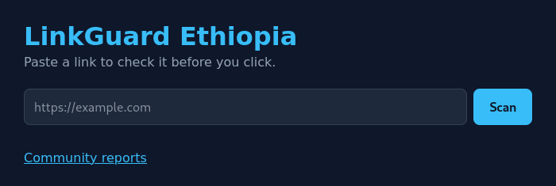

---

## The problem

Scammers use **social engineering**: they trick people instead of hacking computers. A message arrives by SMS, chat app, email or social media. It promises a prize, warns that an account will be closed, or advertises a very cheap product, and it contains a link. The page behind the link looks almost like a real one, so the victim types a password or card number, or pays for goods that never arrive.

An ordinary person cannot tell a scam link from a real one just by looking at it. LinkGuard adds one simple habit: **check first, click second.**

## How it works

1. You paste a link and press **Scan**.
2. The app cleans the link, so the same page always gets the same form, and rejects text that is not a web address.
3. Three independent sources are asked about it:
   - **VirusTotal**: dozens of security engines vote on the link.
   - **urlscan.io**: opens the page in a sandbox and gives its own verdict.
   - **Google Safe Browsing**: Google's list of known dangerous sites.
4. The community database is checked for user reports.
5. Points are added up into a 0-100 score, and every point has a written reason.
6. If any source could not be checked, the result says so instead of pretending the link is safe.

## The app in pictures

### A dangerous link
Google publishes a deliberate test page for phishing detectors. All three sources agree, so the score reaches the maximum.

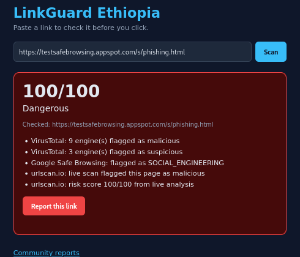

VirusTotal flagged 9 engines as malicious and 3 as suspicious, Google Safe Browsing matched it as social engineering, and urlscan.io called it malicious with a 100/100 score. Together that is well over 100 points, so it is capped at **100 (Dangerous)**.

### A suspicious link
A fake Outlook login page scored 43 out of 100.

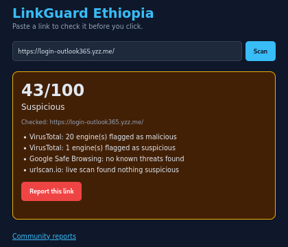

VirusTotal flagged 20 engines as malicious and 1 as suspicious, but VirusTotal's malicious points are capped at 40, so the total is 43 (**Suspicious**). Google Safe Browsing and urlscan.io found nothing. This shows why several sources are better than one, and it also shows a weakness to improve: when many engines agree, the label could be stronger (see "Limitations").

### Unverified results: when a source fails
A made-up domain that does not exist cannot be checked by urlscan.io, and VirusTotal has never seen it.

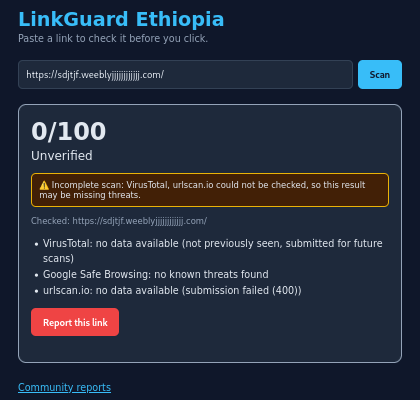

Instead of a misleading green "Safe", the app shows a gray **Unverified** label with a yellow warning that names the sources that could not be checked. After one user reported the same link, the community points were added to the score:

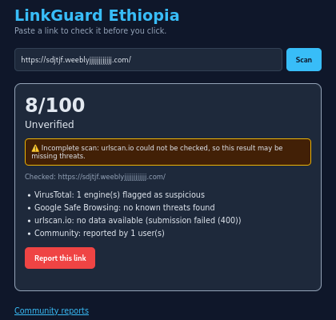

### Input checks
Text that is not a link is rejected with a friendly message.

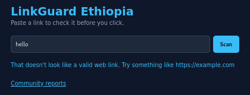

### Community reporting
Any visitor can report a link with one button.

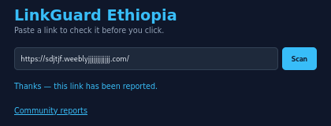

Each visitor can report a link only once, which stops one person from pushing a score up by clicking again and again.

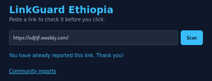

### The moderated public list
Reports are not published automatically. A moderator reviews them first, so the public list starts empty and only shows approved links. Links are shown "defanged" (`hxxps://evil[.]com`) so nobody opens them by accident.

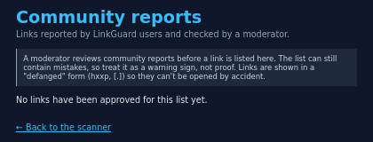

### The admin login
Moderators log in at `/admin`. If the admin secrets are missing, the admin area stays disabled, and five wrong passwords lock a visitor out for 15 minutes.

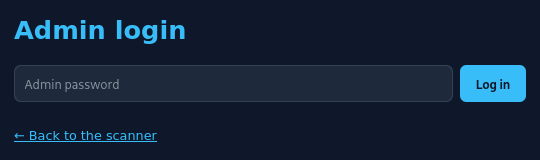
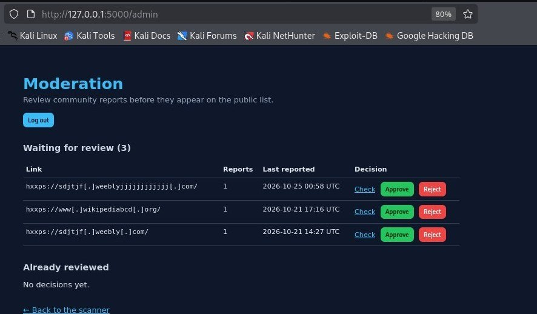

### Running on the Kali Linux virtual machine
The project was built and tested inside an isolated Kali Linux virtual machine.

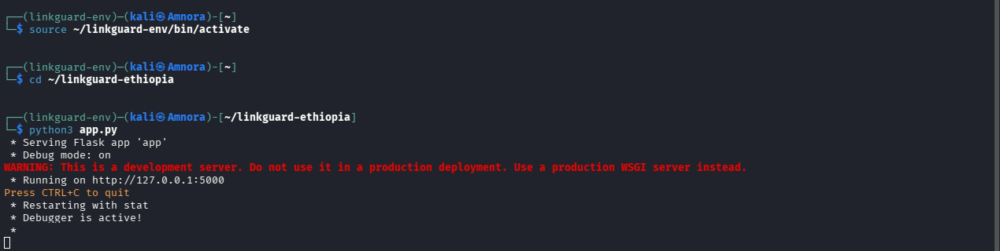

---

## The risk score

| Signal | Points |
|---|---|
| VirusTotal engines flagging malicious | 4 each, max 40 |
| VirusTotal engines flagging suspicious | 3 each, max 10 |
| Google Safe Browsing match | +35 |
| urlscan.io malicious verdict | +30 |
| urlscan.io risk score | 20% of it, max 20 |
| Community reports | 5 each, max 25 |

The total is capped at 100. **0-30 Safe**, **31-60 Suspicious**, **61-100 Dangerous**, and **Unverified** appears instead of Safe when a source has no data. Reports on a link a moderator rejected are not counted.

## Features

- Link scanning with three independent sources
- Risk score with plain-language reasons
- Unverified result and a warning when a check fails
- URL cleanup and input validation
- Community reporting, one report per visitor per link
- Moderated public list with defanged links
- Protected admin area to approve, reject or undo decisions

## Built with

| Part | Technology |
|---|---|
| Safe lab | Kali Linux in VirtualBox (NAT network, clean-baseline snapshot, clipboard off) |
| Language | Python 3 with a virtual environment |
| Web app | Flask, with HTML and CSS in templates |
| Web requests | The `requests` library |
| Database | SQLite |
| Security helpers | Werkzeug, `hashlib`, `hmac`, `secrets` |
| Threat sources | VirusTotal, urlscan.io and Google Safe Browsing APIs |
| Code storage | Git and GitHub |

## How it was built

1. **Safe lab**: a Kali VM with isolated settings and a clean snapshot.
2. **Learn by hand**: use VirusTotal and urlscan.io in the browser first.
3. **Accounts and keys**: three API keys kept in one private file.
4. **Test data**: 15 phishing links and 12 known-good sites.
5. **First scripts**: `vt_check.py` and `urlscan_check.py`.
6. **Batch tester**: `batch_test.py`, with rate-limit handling.
7. **Combined scanner**: `linkguard_scan.py` joins the sources into one score.
8. **Web interface**: `app.py` with Flask and Google Safe Browsing.
9. **Community reporting**: a SQLite database and a Report button.
10. **Hardening**: fixes for problems found during testing.
11. **Moderation**: a public list that needs admin approval.
12. **GitHub**: the project committed with a `.gitignore` that keeps secrets out.

## Problems found in testing, and the fixes

| Problem | Fix |
|---|---|
| One person could report the same link again and again | One report per visitor per link (salted IP hash plus a unique database index) |
| `http://example.com` and `http://example.com/` counted as two links | `normalize_url()` gives every link one standard form |
| A failed source still showed a green Safe | Incomplete-scan warning, and Safe becomes Unverified |
| The public list could be spammed | A moderator approves links, and rejected reports are not counted |
| A forged `X-Forwarded-For` header could dodge the report limit | `ProxyFix` with `TRUSTED_PROXIES`, default 0 |

## Security design

- API keys and admin secrets are kept out of the code and out of GitHub
- Reporter IDs are salted hashes; the raw IP is never stored
- Parameterised SQL queries
- Admin password stored only as a hash, no default password
- CSRF token on every admin form
- Lockout after 5 wrong passwords for 15 minutes
- HttpOnly, SameSite cookie with a 30-minute session
- Security headers on every page
- Reported links shown defanged

## Test results

On a 27-URL test set (15 phishing, 12 legitimate), VirusTotal alone detected 15 of 15 phishing links with 0 of 12 false positives. The legitimate sites were all famous ones, so small, obscure legitimate sites still need testing. The admin and moderation code passed 34 of 34 test checks.

## Project files

| File | Purpose |
|---|---|
| `app.py` | Flask web app: scanner, reporting, moderation, admin |
| `vt_check.py` | Check one URL against VirusTotal |
| `urlscan_check.py` | Scan one URL with urlscan.io |
| `linkguard_scan.py` | Command-line scanner that combines the sources |
| `batch_test.py` | Test a list of known-good and known-bad URLs |
| `bad_urls.txt`, `good_urls.txt` | Test datasets |
| `requirements.txt` | Python libraries needed |
| `screenshots/` | Images used in this README |

## Setup

You need Python 3 and free API keys from [VirusTotal](https://www.virustotal.com), [urlscan.io](https://urlscan.io) and the [Google Safe Browsing API](https://developers.google.com/safe-browsing).

```
git clone https://github.com/niemaDev/linkguard-ethiopia.git ~/linkguard-ethiopia
cd ~/linkguard-ethiopia
python3 -m venv ~/linkguard-env
source ~/linkguard-env/bin/activate
pip install -r requirements.txt
```

### Keys file

Create `linkguard-keys.txt` in the project folder. It is listed in `.gitignore`, so it is never uploaded. Use one `NAME=value` per line:

```
VIRUSTOTAL_API_KEY=your-key
URLSCAN_API_KEY=your-key
GOOGLE_SAFE_BROWSING_KEY=your-key
REPORT_SALT=any-long-random-string
```

Create the admin secrets (the second command asks for a password and nothing shows while you type):

```
echo "" >> linkguard-keys.txt
python3 -c "import secrets; print('SECRET_KEY=' + secrets.token_hex(32))" >> linkguard-keys.txt
python3 -c "import getpass; from werkzeug.security import generate_password_hash as g; print('ADMIN_PASSWORD_HASH=' + g(getpass.getpass('Choose an admin password: ')))" >> linkguard-keys.txt
```

### Run

```
python3 app.py
```

Open http://127.0.0.1:5000. Moderators log in at http://127.0.0.1:5000/admin. The database tables are created automatically on first start.

### Forgot the admin password?

The password is stored only as a one-way hash, so it cannot be read back, but it can be replaced. Stop the server, then run:

```
echo "" >> linkguard-keys.txt
python3 -c "import getpass; from werkzeug.security import generate_password_hash as g; print('ADMIN_PASSWORD_HASH=' + g(getpass.getpass('New admin password: ')))" >> linkguard-keys.txt
```

The app uses the last `ADMIN_PASSWORD_HASH` line in the file. Start the server again and log in with the new password. If an `ADMIN_PASSWORD_HASH` environment variable is set, it takes priority over the file.

## Limitations

- Free API plans are rate limited, and a full scan takes about 15-30 seconds
- urlscan.io free scans are public, so private links should not be submitted
- Scoring weights need tuning: VirusTotal points are capped, so a link flagged by 20 engines can still show only Suspicious
- The one-report limit depends on the IP address, so it is a speed bump, not a guarantee
- The admin lockout counter lives in memory and resets when the server restarts
- The "good" test set contained only famous sites

## Roadmap

- Tune the weights, for example raise the score when many engines agree
- More signals: domain age, SSL problems, redirect chains, look-alike brand names
- Test with small, legitimate, obscure sites to measure false alarms
- Deploy with debug mode off and a production server
- Loading indicator and scan history

## Key terms

- **Phishing**: a fake site or message that imitates a trusted one to steal data
- **Social engineering**: tricking people instead of hacking computers
- **Sandbox**: an isolated space where a page can be opened safely
- **Hash and salt**: a one-way scrambled version of data, with a secret extra string mixed in
- **CSRF**: an attack where another site tricks your logged-in browser; a secret token stops it
- **Defang**: rewrite a link (`hxxp`, `[.]`) so it cannot be clicked by accident

## Safety note

Only test with links you are comfortable handling, and keep your API keys private.

